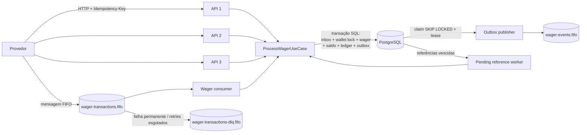
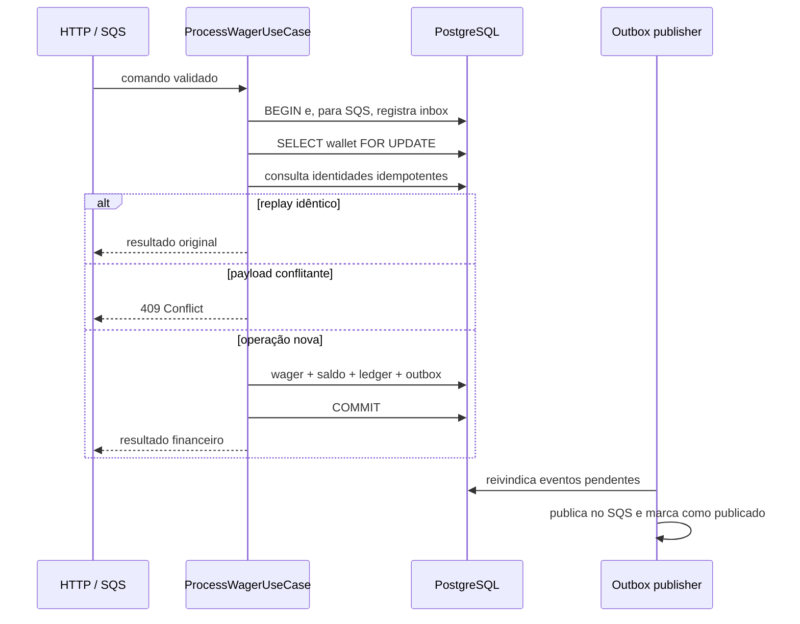

# Distributed Wagering Processor - Joao Gomes

Serviço financeiro distribuído para processar `BET`, `WIN`, `LOSS`, `REFUND` e `ROLLBACK` com segurança diante de mensagens duplicadas, referências fora de ordem, concorrência, múltiplas instâncias e falhas entre o commit e a confirmação da mensagem.

**Stack:** Bun 1.4 · TypeScript strict · NestJS 12 · MikroORM 7 · PostgreSQL 16 · Amazon SQS (LocalStack) · Docker Compose

| Documento | Conteúdo |
|---|---|
| [`README.md`](README.md) | execução, arquitetura, garantias, API e verificação |
| [`ARCHITECTURE.md`](ARCHITECTURE.md) | decisões técnicas, fluxos, trade-offs e limitações |
| [`docs/TESTING.md`](docs/TESTING.md) | estratégia e apresentação das evidências de teste |
| [`docs/REQUIREMENTS.md`](docs/REQUIREMENTS.md) | conformidade requisito por requisito |
| [`docs/LOAD_TEST.md`](docs/LOAD_TEST.md) | metodologia e resultados do teste de carga |
| [`docs/failure-codes.md`](docs/failure-codes.md) | códigos de falha estáveis |
| [`docs/api-examples.http`](docs/api-examples.http) | exemplos executáveis da API HTTP |

**Evidência atual:** 165 testes, 0 falhas e 406 assertions na suíte padrão, além de cinco cenários de concorrência com três processos reais.

---

## Como executar

Pré-requisitos: Docker Desktop e Bun 1.4.x para executar testes fora dos containers.

```powershell
$env:POSTGRES_EXPOSED_PORT='55432'
docker compose up -d --build
```

O Compose inicia PostgreSQL em `55432`, LocalStack/SQS em `4566`, cria as filas, executa migrations em um container one-shot e inicia três instâncias da API em `3000`, `3001` e `3002`. Cada instância executa os consumers, o publisher do outbox e o worker de referências pendentes.

```powershell
Invoke-RestMethod http://localhost:3000/health/live
Invoke-RestMethod http://localhost:3000/health/ready
```

Readiness esperado:

```json
{
  "status": "ok",
  "dependencies": { "postgres": "up", "sqs": "up" }
}
```

Para encerrar e remover os volumes locais:

```powershell
docker compose down --volumes
```

---

## Arquitetura



A solução é organizada por contexto (`wallet`, `wagering`, `messaging`, `health`, `database` e `shared`) e separa domínio, aplicação, infraestrutura e interfaces. O domínio financeiro não depende de NestJS, MikroORM ou AWS.

HTTP e SQS reutilizam o mesmo caso de uso. A coordenação entre instâncias não depende de memória local: locks, unicidade, inbox, outbox e estados persistidos vivem no PostgreSQL.

### Fluxo de uma operação



---

## Garantias e mecanismos

| Garantia | Mecanismo | Evidência |
|---|---|---|
| Dinheiro exato | `decimal.js`, precisão 80 e `NUMERIC(20,2)` como string | testes de `Money`, persistência e valores elevados |
| Saldo nunca negativo | regra de domínio + `CHECK` no PostgreSQL | corrida com saldo 100 e duas apostas de 80 |
| Sem lost update | `SELECT ... FOR UPDATE` por carteira | testes concorrentes com três processos |
| Idempotência persistente | chaves únicas + hash canônico SHA-256 | mesma aposta enviada 50 vezes em paralelo |
| Ledger auditável | uma entrada por efeito e trigger contra `UPDATE`/`DELETE` | testes diretos das constraints |
| Atomicidade | wager, saldo, ledger, inbox e outbox na mesma transação SQL | testes de commit e rollback |
| Eventos não são perdidos | transactional outbox com lease e `SKIP LOCKED` | publishers concorrentes e retomada |
| Redelivery segura | inbox persistente e ack somente após commit | queda entre commit e ack |
| Referência fora de ordem | `PENDING_REFERENCE`, backoff e reprocessamento | `REFUND`/`ROLLBACK` antes da referência |
| Reconciliação | saldo reconstruído do ledger com decimal exato | testes de reconciliação |

---

## Regras financeiras

| Operação | Efeito no saldo | Ledger | Regra principal |
|---|---|---|---|
| `BET` | débito | `DEBIT` | rejeitada quando o saldo é insuficiente |
| `WIN` | crédito | `CREDIT` | registra o ganho da rodada |
| `LOSS` | nenhum | nenhum | processada sem movimentar saldo |
| `REFUND` | crédito | `CREDIT` | reverte uma `BET` processada uma vez |
| `ROLLBACK` | inverso da referência | direção invertida | reverte `BET`, `WIN` ou `REFUND` |

Invariantes:

- no máximo uma carteira por `playerId` e moeda;
- moeda da operação igual à moeda da carteira;
- `REFUND` e `ROLLBACK` exigem referência externa;
- referência com mesmo provider, player, wallet, round, moeda e valor;
- estados `PROCESSED`, `REJECTED` e `FAILED` são terminais;
- `OPENING` é exclusivamente interno;
- replay idêntico devolve o saldo observado originalmente;
- mesma chave idempotente com payload diferente é conflito.

---

## Idempotência e concorrência

Cada operação possui duas identidades persistentes: `idempotencyKey` e `(providerId, externalTransactionId)`. O payload de negócio é transformado em JSON canônico e resumido com SHA-256. Metadados de transporte não participam do hash.

A unidade de concorrência é a carteira. O lock pessimista serializa somente operações que competem pelo mesmo saldo; carteiras diferentes seguem em paralelo.

```text
saldo inicial: 100.00 BRL
duas BET concorrentes: 80.00 BRL cada

resultado:
- uma PROCESSED
- uma REJECTED por saldo insuficiente
- saldo final 20.00 BRL
- exatamente um débito no ledger
```

---

## Mensageria, inbox e outbox

O consumer lê `wager-transactions.fifo`, valida o envelope e usa o mesmo caso de uso da API HTTP.

- duplicatas são absorvidas pelo inbox persistente;
- erros de negócio são terminais e recebem ack;
- falhas transitórias retornam para retry;
- mensagens inválidas ou permanentemente impossíveis seguem para a DLQ;
- ack somente depois do commit;
- shutdown para novas buscas e aguarda o trabalho em andamento;
- `OPENING` não é aceito pela fila externa.

Eventos são gravados no outbox na transação financeira. Publishers concorrentes reivindicam lotes com `FOR UPDATE SKIP LOCKED` e lease. Se uma instância morrer depois de publicar e antes de marcar, o mesmo `eventId` pode ser republicado: a entrega é **at-least-once** e o consumidor downstream deve deduplicar esse ID.

Eventos produzidos:

- `WagerTransactionProcessed`;
- `WagerTransactionRejected`;
- `WagerTransactionPendingReference`;
- `WalletBalanceChanged`, somente quando o saldo muda.

---

## Referências fora de ordem

Um `REFUND` ou `ROLLBACK` cuja referência ainda não chegou fica em `PENDING_REFERENCE`. O worker reivindica registros vencidos com `SKIP LOCKED`, procura a referência e reaplica as mesmas regras financeiras. O backoff é exponencial, limitado a uma hora; após dez tentativas, a operação é rejeitada com `REFERENCE_NOT_FOUND`.

Múltiplas instâncias podem executar esse worker sem aplicar a reversão duas vezes.

---

## API HTTP

```http
POST /wallets
GET  /wallets/:walletId
GET  /wallets/:walletId/ledger?cursor=...&limit=50
POST /wallets/:walletId/reconciliation

POST /wagering/transactions
GET  /wagering/transactions/:transactionId
GET  /providers/:providerId/wagering/transactions/:externalTransactionId

GET  /health/live
GET  /health/ready
GET  /metrics
```

### Criar uma carteira

```http
POST /wallets
Content-Type: application/json

{
  "playerId": "0192f28f-5dc0-7d58-bdb2-814ad6a0f4a1",
  "initialBalance": { "amount": "100.00", "currency": "BRL" }
}
```

Saldo inicial positivo cria uma transação interna `OPENING` e uma entrada `CREDIT` no ledger, atomicamente.

### Processar uma aposta

```http
POST /wagering/transactions
Content-Type: application/json
Idempotency-Key: provider-a:bet-123

{
  "providerId": "provider-a",
  "externalTransactionId": "bet-123",
  "playerId": "0192f28f-5dc0-7d58-bdb2-814ad6a0f4a1",
  "walletId": "0192f291-27dd-7d3f-8071-5f8685deef37",
  "roundId": "round-987",
  "gameId": "fortune-chimp",
  "kind": "BET",
  "money": { "amount": "25.00", "currency": "BRL" }
}
```

```json
{
  "transactionId": "0192f298-345e-7e38-af88-e43f851a819d",
  "status": "PROCESSED",
  "balance": { "amount": "75.00", "currency": "BRL" },
  "idempotentReplay": false
}
```

### Mapeamento HTTP

| Situação | Status |
|---|---:|
| processada | `201` |
| referência pendente | `202` |
| payload ou header inválido | `400` |
| recurso não encontrado | `404` |
| conflito de idempotência ou carteira duplicada | `409` |
| rejeição por regra financeira | `422` |
| dependência indisponível no readiness | `503` |

Veja [`docs/api-examples.http`](docs/api-examples.http) e [`docs/failure-codes.md`](docs/failure-codes.md).

---

## Reconciliação

`POST /wallets/:walletId/reconciliation` lê o ledger em ordem estável, reconstrói o saldo a partir de zero com `Money` e compara o resultado ao saldo materializado.

```json
{
  "walletId": "0192f291-27dd-7d3f-8071-5f8685deef37",
  "storedBalance": { "amount": "75.00", "currency": "BRL" },
  "calculatedBalance": { "amount": "75.00", "currency": "BRL" },
  "difference": { "amount": "0.00", "currency": "BRL" },
  "consistent": true,
  "checkedEntries": 2
}
```

Divergências são sinalizadas, registradas e contabilizadas, mas nunca corrigidas silenciosamente.

---

## Observabilidade e operação

- logs JSON com IDs de correlação, transação, carteira e provedor;
- payloads financeiros, tokens e segredos removidos dos logs;
- métricas em memória para status, duplicatas, latência, locks, retries, DLQ, outbox lag e reconciliação;
- liveness sem dependências e readiness de PostgreSQL/SQS;
- parada graciosa dos workers.

`GET /metrics` expõe o formato Prometheus por instância. Grafana/OpenTelemetry e agregação externa não fazem parte desta entrega.

---

## Testes

Com o Compose ativo, pare as APIs para que os workers não consumam dados controlados pelas suítes:

```powershell
docker compose stop app app-2 app-3
$env:TEST_POSTGRES_PORT='55432'
bun install --frozen-lockfile
bun run build
bun run test
bun run test:report
```

`test:report` gera `reports/junit.xml`, ignorado pelo Git para sempre representar a execução atual.

```text
165 pass
0 fail
406 expect() calls
28 arquivos de teste
```

### Concorrência com processos reais

```powershell
bun run test:concurrency
```

| Cenário | Resultado esperado |
|---|---|
| mesma aposta 50 vezes | um único efeito financeiro |
| duas apostas disputando saldo | uma processada e uma rejeitada |
| carteiras distintas em paralelo | nenhuma contenção global |
| tráfego entre três instâncias | consistência final preservada |
| queda após commit e antes do ack | replay sem novo débito |

Também são testados migrations `up/down/up`, constraints, ledger imutável, atomicidade, inbox, publishers concorrentes, retry, DLQ, referências pendentes, API E2E, health e reconciliação.

---

## Segurança e autenticação

`ProviderAuthGuard` é o ponto de extensão das APIs de negócio e intencionalmente permite requisições nesta entrega. Em produção, deve validar JWT/OIDC e vincular as claims ao `providerId`. Health permanece público; SQS deve usar identidade e políticas da infraestrutura.

As credenciais `wagering` e `test` são exclusivamente locais. Produção deve injetar secrets próprios.

---

## Decisões que valem discussão

- **Lock pessimista por carteira:** previsibilidade em hot wallets e ausência de lost update.
- **PostgreSQL como fonte de verdade:** FIFO ajuda, mas não substitui locks e constraints.
- **Transactional outbox:** evita eventos antes do commit e troca perda por duplicidade deduplicável.
- **Saldo materializado + ledger:** leitura rápida com trilha auditável e reconciliação.
- **Rejeições persistidas:** regras de negócio não são confundidas com falhas transitórias.
- **Autenticação como extensão:** o timebox priorizou as invariantes financeiras.

---

## Limitações conhecidas

- autenticação real não implementada;
- métricas em memória sem exporter Prometheus/OpenTelemetry;
- cursor opaco e validado, mas sem HMAC;
- eventos at-least-once, não exactly-once;
- reconciliação sem reparo automático;
- três instâncias sem load balancer;
- nenhum benchmark formal de throughput foi executado.

Veja detalhes em [`ARCHITECTURE.md`](ARCHITECTURE.md).

---

## Histórico de implementação

| Commit | Entrega |
|---|---|
| `3b5c3e1` | bootstrap NestJS, Bun e estrutura modular |
| `d904e2e` | dinheiro decimal exato |
| `f140b54` | domínio de wallet, wager e ledger |
| `3577d64` | persistência, migrations e constraints |
| `2b2bd95` | API financeira atômica e idempotente |
| `f66a93c` | eventos no transactional outbox |
| `213c03a` | consumer SQS e inbox persistente |
| `a9f3e72` | publisher seguro entre instâncias |
| `64e9255` | recuperação de referências fora de ordem |
| `c95e3c7` | consultas, reconciliação e observabilidade |
| `32f3c0d` | testes concorrentes com três processos |
| `373bcac` | documentação e preparação da entrega |
